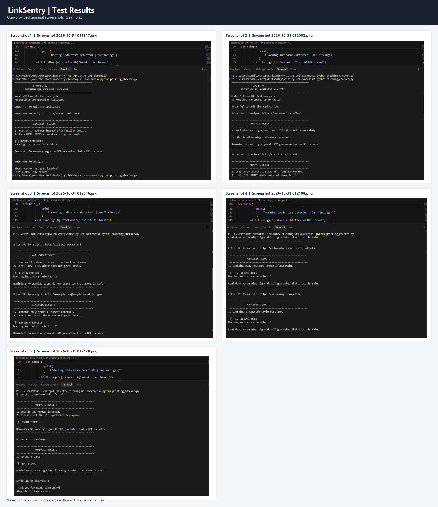

# 🛡️ LinkSentry — Phishing URL Awareness Analyzer

<p align="center">
  <strong>A lightweight, offline Python-based tool for identifying common phishing URL warning signs.</strong>
</p>

<p align="center">
  
  
  
  
  
</p>

---

## 📌 Overview

**LinkSentry** is a command-line phishing URL awareness analyzer developed using Python. It helps users examine suspicious URLs before clicking by identifying selected characteristics commonly associated with deceptive or potentially malicious links.

Instead of relying on external APIs or online reputation services, LinkSentry performs local, text-based analysis and presents understandable warnings to the user.

The objective is simple: encourage safer browsing habits by helping users recognize suspicious URL patterns.

> 🔒 **Privacy by Design:** LinkSentry analyzes URL text locally. It does not open websites, establish network connections, or transmit submitted URLs to third-party services.

## 🎯 Project Objectives

- Identify recognizable warning signs in potentially suspicious URLs.
- Provide clear explanations for detected indicators.
- Perform URL analysis without internet connectivity.
- Handle malformed and empty user input gracefully.
- Support continuous URL inspection within a single session.
- Promote cybersecurity awareness without claiming definitive threat detection.

## ⚙️ Key Features

| Feature | Description |
|---|---|
| Offline URL Analysis | Examines URL text locally without network requests. |
| Six Heuristic Checks | Identifies selected URL characteristics associated with phishing risks. |
| Clear Warning Messages | Explains the indicators detected during analysis. |
| Continuous Inspection | Allows users to analyze multiple URLs in one session. |
| Input Validation | Handles empty and malformed input without terminating unexpectedly. |
| Graceful Exit | Supports `q`, `quit`, and `exit` commands. |
| Lightweight Implementation | Uses Python's built-in libraries without additional dependencies. |

## 🔍 Detection Mechanism

LinkSentry implements six rule-based checks to identify selected URL warning indicators.

| No. | Detection Check | Description |
|---|---|---|
| 01 | `@` Symbol Detection | Flags URLs containing an at-sign, which can be used to make a URL appear misleading. |
| 02 | URL Length Analysis | Flags URLs exceeding 100 characters. |
| 03 | IP Address Detection | Identifies an IPv4-shaped hostname instead of a conventional domain name. |
| 04 | Subdomain Analysis | Flags hostnames containing five or more dot-separated labels. |
| 05 | Punycode Detection | Identifies hostnames containing the `xn--` prefix. |
| 06 | HTTP Protocol Check | Flags URLs using HTTP rather than HTTPS. |

**Important:** These checks are heuristic indicators, not proof of malicious activity. A URL may be legitimate and still trigger a warning.

## 🛠️ Technology Stack

| Technology | Purpose |
|---|---|
| Python 3 | Core programming language |
| `urllib.parse` | URL parsing and hostname extraction |
| `re` | Pattern matching for IP-address-shaped hostnames |
| Command-Line Interface | User interaction and result display |
| Git & GitHub | Version control and project hosting |

No third-party Python packages are required.

## 🖥️ Application Workflow

1. The user launches LinkSentry from a terminal.
2. The application requests a URL.
3. The URL is parsed locally.
4. Six heuristic checks are performed.
5. Detected indicators are collected.
6. The application displays the analysis results and a safety reminder.
7. The user can enter another URL or exit the application.

## 🚀 Getting Started

### Prerequisites

- Python 3.10 or later recommended.
- Windows, Linux, or macOS.
- A terminal or command-line environment.

### 1. Clone the Repository

```bash
git clone https://github.com/komal2327/linksentry-phishing-url-analyzer.git
```

### 2. Navigate to the Project Directory

```bash
cd .\phishing-url-awareness\
```

### 3. Run the Application

```bash
python phishing_checker.py
```

On systems where Python is configured differently, try:

```bash
python3 phishing_checker.py
```

On Windows, you can also use:

```powershell
py phishing_checker.py
```

### 4. Start Analyzing URLs

Enter a URL when prompted. To close the application, enter:

```text
q
```

You can also use `quit` or `exit`.

## 📊 Sample Execution

### Example: URL Containing an IP Address

**Input:**

```text
http://192.0.2.10/account
```

**Output:**

```text
=======================================================
             LINKSENTRY
       PHISHING URL AWARENESS ANALYZER
=======================================================
Mode: Offline URL text analysis
No websites are opened or contacted.

Enter 'q' to quit the application.

Enter URL to analyze: http://192.0.2.10/account

-------------------------------------------------------
             ANALYSIS RESULTS
-------------------------------------------------------
1. Uses an IP address instead of a familiar domain.
2. Uses HTTP. HTTPS alone does not prove trust.

[!] REVIEW CAREFULLY
Warning indicators detected: 2

Reminder: No warning signs do NOT guarantee that a URL is safe.
-------------------------------------------------------
```

The application identifies two warning indicators and explains why the URL should be reviewed carefully.

## 🧪 Testing and Validation

The application is evaluated using manual test cases covering normal URLs, suspicious URL patterns, malformed input, and application exit behavior.

| Test Case | Scenario | Expected Behavior |
|---|---|---|
| TC01 | Normal HTTPS URL | No listed warning indicators |
| TC02 | IPv4 address as hostname | IP address and HTTP warnings |
| TC03 | URL containing `@` | At-sign and HTTP warnings |
| TC04 | Multiple hostname segments | Subdomain warning |
| TC05 | Punycode hostname | Punycode warning |
| TC06 | Malformed URL | Error handled without application crash |
| TC07 | Empty input | Empty-input message |
| TC08 | Exit command | Application terminates gracefully |

Detailed manual test cases and observed results are documented in [`tests/test_samples.md`](tests/test_samples.md).

*Test status should be updated based on actual execution results.*

## 📸 Screenshots

### Application Execution


### Test Results



## 📁 Project Structure

```text
linksentry-phishing-url-analyzer/
│
├── phishing_checker.py
│
├── README.md
├── requirements.txt
├── .gitignore
│
├── tests/
│   └── test_samples.md
│
└── screenshots/
    ├── sample_run.png
    └── test_results.png
```

## 🔧 Improvements Implemented

### 1. Malformed Input Handling

Added exception handling around URL parsing to prevent malformed URL input from unexpectedly terminating the application.

### 2. Continuous URL Inspection

Implemented a continuous input loop that allows users to analyze multiple URLs in a single session, with dedicated exit commands.

### 3. Clear User Feedback

Added structured analysis output, warning messages, and safety reminders to make the results easier to understand.

## ⚠️ Limitations and Security Considerations

LinkSentry is an educational cybersecurity awareness tool. It is not a full-fledged phishing detection engine.

- It does not connect to websites or inspect their content.
- It does not follow redirects or analyze landing pages.
- It does not use threat-intelligence feeds or domain reputation databases.
- Its heuristic checks can produce false positives and false negatives.
- A URL without detected warning indicators may still be malicious.
- HTTPS indicates an encrypted connection, not the legitimacy of a website.

**Security recommendation:** Never rely exclusively on an automated URL checker. Verify unexpected links independently and access important services through trusted bookmarks or known website addresses.

## 🔮 Future Enhancements

Potential extensions for future development include:

- Graphical User Interface (GUI) using Tkinter.
- Domain reputation checks through trusted threat-intelligence APIs.
- Redirect-chain analysis.
- Detection of suspicious URL encoding and homoglyph characters.
- Exportable analysis reports.
- Automated unit testing.

These are proposed enhancements and are not part of the current implementation.

## 🎓 Project Information

**Project Name:** LinkSentry — Phishing URL Awareness Analyzer  
**Domain:** Cybersecurity  
**Category:** Python Development | Security Awareness  
**Interface:** Command-Line Interface (CLI)  
**Execution Mode:** Offline

## 👩‍💻 Author

**Komal Kumari Shaw**

Cybersecurity Enthusiast | SOC Analysis | Vulnerability Assessment & Penetration Testing

- GitHub: [@komal2327](https://github.com/komal2327)
- Project Repository: [LinkSentry](https://github.com/komal2327/linksentry-phishing-url-analyzer)

---

<p align="center">
  <strong>Think Before You Click. Stay Alert. Stay Secure. 🛡️</strong>
</p>
