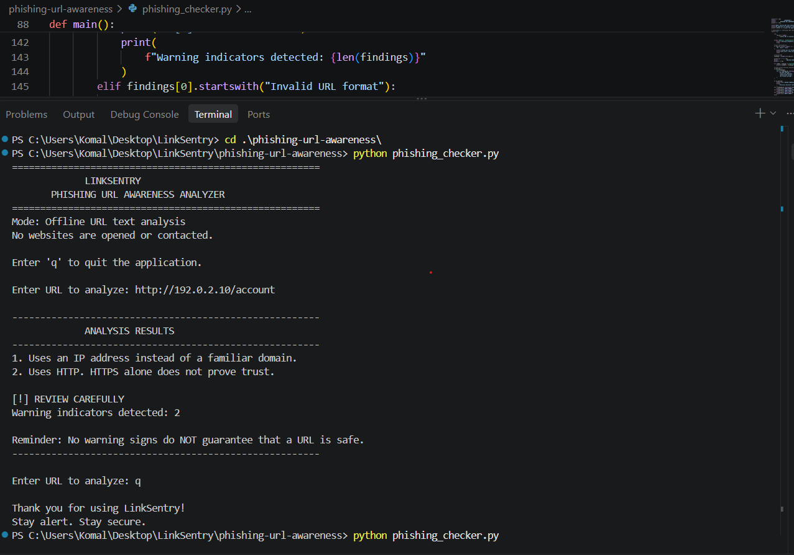

# LinkSentry

### A lightweight, offline phishing URL awareness analyzer

LinkSentry helps users pause and inspect a URL before clicking. It looks for a handful of recognizable warning signs, explains what it found, and reminds users that a clean result is **not** proof that a link is safe.

> **Private by design:** LinkSentry analyzes URL text locally. It does not open the link, contact a website, or send the URL to a third party.



## Why LinkSentry?

- **Offline by default** — no network requests, API keys, or URL submissions.
- **Easy to run** — a simple interactive Python command-line interface.
- **No extra dependencies** — built using Python's standard library.
- **Clear explanations** — shows the warning signs it noticed, instead of returning an unexplained verdict.
- **Built for awareness** — encourages careful link handling without claiming to replace security tools.

## What it checks

LinkSentry examines URL text for these selected indicators:

| Indicator | What LinkSentry reports |
|---|---|
| `@` symbol | The URL contains an at-sign; inspect it carefully. |
| URL longer than 100 characters | The URL is unusually long. |
| IPv4 address as hostname | The hostname is an IP address rather than a familiar domain. |
| Five or more hostname labels | The hostname contains many segments or subdomains. |
| `xn--` in hostname | The hostname contains a punycode-style label. |
| HTTP scheme | The URL uses HTTP; HTTPS alone does not prove trust. |

These are simple text-based heuristics, not a threat-intelligence lookup or a definitive phishing detection system.

## Getting started

### Requirements

- Python 3
- No third-party packages

### Run

Open a terminal in this project directory and start the analyzer:

```bash
cd .\phishing-url-awareness\
python phishing_checker.py
```

Enter a URL when prompted. You can check multiple URLs in one session. Enter `q`, `quit`, or `exit` to leave the program.

If the `python` command is not available on your system, try `python3` (macOS/Linux) or `py` (Windows):

```bash
cd .\phishing-url-awareness\
python3 phishing_checker.py
```

## Project structure

```text
phishing-url-awareness/
├── phishing_checker.py       # Interactive offline URL analyzer
├── README.md                  # Project overview and usage guide
├── requirements.txt           # Documents that no extra packages are needed
├── tests/
│   └── test_samples.md        # Manual sample cases and observed results
└── screenshots/
    ├── sample_run.png         # Example analyzer session
    └── test_results.png       # Test-result screenshot
```

## Example

```text
Enter URL to analyze: http://192.0.2.10/account

ANALYSIS RESULTS
1. Uses an IP address instead of a familiar domain.
2. Uses HTTP. HTTPS alone does not prove trust.

[!] REVIEW CAREFULLY
Warning indicators detected: 2
```

The program then displays a safety reminder and returns to the prompt.

## Screenshots and sample cases

The [manual test evidence](tests/test_samples.md) describes the sample inputs and observed behavior. Additional terminal screenshots are available in the [shared test-results folder](https://drive.google.com/drive/folders/1sslceWflxJ4_b3HjVkr1mbDiP-LFS3UZ?usp=sharing).

## Important limitations

- A warning is a reason to take a closer look, not proof that a URL is malicious.
- No warning signs does **not** mean a URL is safe.
- Legitimate URLs may trigger warnings, and phishing URLs may not trigger any.
- LinkSentry does not visit the site, inspect its page, follow redirects, or check a live reputation database.
- HTTPS encrypts a connection but does not establish that the site itself is trustworthy.

When in doubt, avoid clicking an unexpected link. Visit the organization using a trusted bookmark or by typing its known address yourself.
